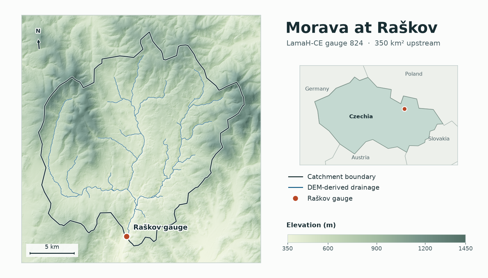
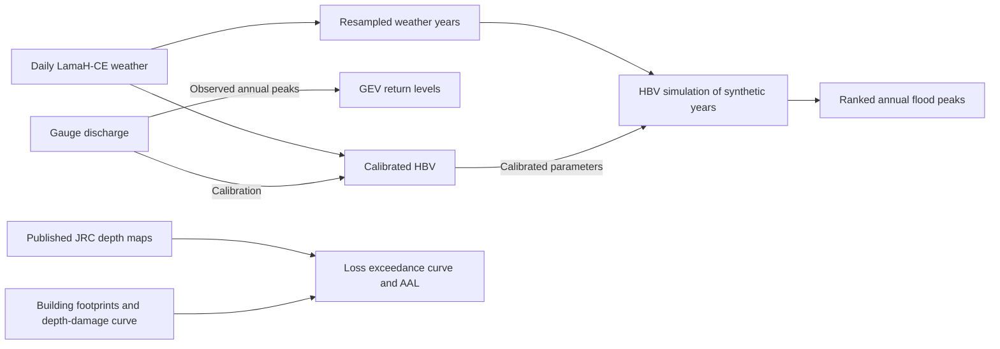
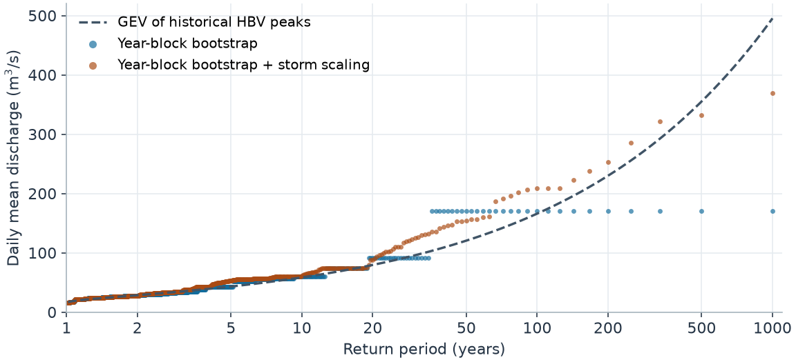
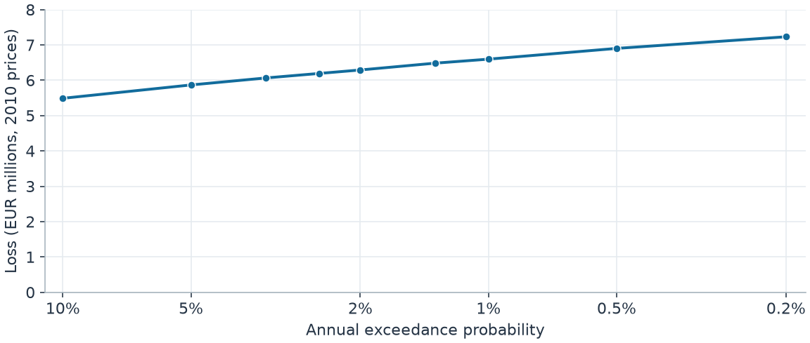

# rain2loss — from rainfall to flood loss, Morava at Raškov (Czechia)

rain2loss is a flood catastrophe modelling case study for the 350 km² Morava catchment upstream of Raškov (LamaH-CE gauge 824). It estimates daily river discharge, flood return levels and synthetic annual flood peaks. A separate calculation combines published inundation maps with building footprints and depth-damage functions to estimate direct damage to buildings and contents, including average annual loss (AAL). The September 2024 Storm Boris case study uses the modelled peak to select an inundation scenario.



The catchment boundary and gauge are from LamaH-CE. The Czechia locator uses Natural Earth boundaries. [LamaH-CE](https://zenodo.org/records/5153305) · [Natural Earth](https://www.naturalearthdata.com/downloads/110m-cultural-vectors/110m-admin-0-countries/)

*Terrain and drainage produced using Copernicus WorldDEM-30 © DLR e.V. 2010-2014 and © Airbus Defence and Space GmbH 2014-2018 provided under COPERNICUS by the European Union and ESA; all rights reserved.* [Copernicus DEM](https://dataspace.copernicus.eu/explore-data/data-collections/copernicus-contributing-missions/collections-description/COP-DEM)

## Pipeline



1. **Rainfall-runoff.** HBV uses basin-average ERA5-Land precipitation and temperature from LamaH-CE, with potential evapotranspiration estimated by the Oudin method. The default model simulates snow in three equal-area elevation zones, then pools their inputs for catchment-wide soil moisture, reservoir storage and streamflow routing. Calibration selects the 14 model parameters against daily gauge discharge using Kling-Gupta efficiency (KGE). [HBV model](src/rain2loss/hbv.py) · [Calibration](src/rain2loss/calibration.py)
2. **Flood frequency and events.** A generalised extreme value (GEV) distribution is fitted to observed annual maxima of daily mean discharge. To generate synthetic peaks, the model resamples complete November-October weather years and discards the first simulated year as warm-up. The largest remaining annual peak gets the longest empirical return period, using `(n + 1) / rank` for `n` retained peaks. [Extreme-value methods](src/rain2loss/evt.py)
3. **Hazard, exposure and loss.** The loss calculation uses the return periods assigned to the published JRC maps. It samples depth at a representative point inside each OpenStreetMap building footprint and multiplies the interpolated damage ratio by the footprint area and €587.20/m². The code converts each return period `T` to an annual exceedance probability of `1 / T` and integrates the resulting loss curve to estimate AAL. [Loss methods](src/rain2loss/loss.py)

## How to run

### Set up the environment

From the repository root, create the Conda environment with Python 3.13 and install `rain2loss` in editable mode.

```sh
conda env create -f environment.yml
conda activate rain2loss
python -m pip install -e .
```

The unit tests use synthetic inputs and can run before the data downloads. [Test suite](tests/)

```sh
python -m pytest -q
```

### Prepare the inputs

1. Download `2_LamaH-CE_daily.tar.gz` and extract it under `data/raw/LamaH-CE/`. The `A_basins_total_upstrm/` and `D_gauges/` directories should sit directly inside that directory. The pipeline reads their attributes and daily time series, and the loss notebook uses the basin shapefile. Keep `F_hydrol_model/` for the notebook's COSERO comparison. [LamaH-CE archive](https://zenodo.org/records/5153305)
2. Launch `jupyter lab` from the repository root and run the first four code cells of the loss notebook. They fetch the cropped JRC maps and query OpenStreetMap for the building portfolio. The resulting inputs are `data/processed/buildings_824.gpkg` and nine `data/processed/jrc/jrc_rp*_824.tif` depth rasters. Downloads and the building query require internet access when local files and cached responses are unavailable. [Loss notebook](notebooks/07_loss.ipynb)

### Run the pipeline

```sh
python -m rain2loss.run --config config.yaml
```

Input and output paths in the configuration are relative to the repository root when the command is run there. The default run uses 5,000 DDS calibration evaluations, seed 42 and 1,000 resampled years with storm scaling (`storm_sigma: 0.2`). Set `storm_sigma: 0` for plain year-block resampling. The two `return_periods` lists control the discharge-frequency estimates and the JRC loss scenarios, respectively. [Default configuration](config.yaml)

| File under `results/run_824/` | Contents |
| --- | --- |
| `hbv_params.json`, `hbv_scores.csv` | Fitted parameters and daily calibration and validation scores |
| `flood_frequency.csv` | GEV return levels from observed peaks using L-moments, with bootstrap bounds |
| `event_set.csv` | One peak per retained synthetic year, with source year and empirical return period |
| `loss_by_return_period.csv`, `aal.json` | Loss and flooded-building count for each hazard map, plus AAL in euros per year |
| `run.log` | Stage timing and run diagnostics |

On reruns the CLI reuses `hbv_params.json` in the output directory and recomputes the downstream results. Set `hbv.recalibrate: true` or use a fresh `output_dir` after changing the gauge, calibration settings or forcing data. The checked-in `results/hbv_params_824.json` stores parameters and elevation zones for the notebooks in a different format. [CLI runner](src/rain2loss/run.py)

## Notebook guide

The results below come from the checked-in notebook outputs, tables and figures. The CLI reports one configured HBV fit and one event-set variant. The notebooks also compare both calibration algorithms with COSERO, fit GEV by maximum likelihood, compare the two synthetic event sets and work through Storm Boris.

| Notebook | What to run it for |
| --- | --- |
| [01 · Explore LamaH-CE](notebooks/01_explore_lamah.ipynb) | Inspect candidate gauges, record completeness and historical peaks. |
| [02 · HBV](notebooks/02_hbv.ipynb) and [03 · Calibration](notebooks/03_calibration.ipynb) | Inspect the model's water balance, fit DDS and SCE-UA and compare daily scores with COSERO. Notebook 03 saves the DDS parameters and zones used by notebooks 06 and 08. |
| [04 · Raster GIS](notebooks/04_raster_gis.ipynb) and [05 · DEM catchment](notebooks/05_dem_catchment.ipynb) | Subset E-OBS rainfall and explore terrain, drainage and height above nearest drainage (HAND). The optional terrain steps in 04 use `gdalbuildvrt` and `gdalwarp` on `PATH`. Notebook 05 builds the HAND raster used in the final diagnostic in notebook 07. |
| [06 · Extremes and event sets](notebooks/06_extremes_event_set.ipynb) | Compare GEV fits to observed peaks and generate both synthetic event sets from the saved DDS fit. |
| [07 · Loss](notebooks/07_loss.ipynb) | Prepare the JRC and building inputs, estimate portfolio loss and examine suspect depths. |
| [08 · Storm Boris](notebooks/08_boris_2024.ipynb) | Run the retrospective event analysis with saved HBV parameters and notebook 07's hazard and exposure files. Run the first three code cells of 04 first to prepare the E-OBS rainfall subset. Notebook 08 fetches and subsets the temperature input. |

## Results

### HBV vs COSERO

Daily discharge scores for calibration (Jan 1982–Sep 2000) and validation (Oct 2000–Sep 2017). COSERO has the highest validation Nash-Sutcliffe efficiency (NSE). SCE-UA and COSERO give nearly identical validation KGE. [Full scores](results/hbv_scores_824.csv)

| Model | Cal. NSE | Cal. KGE | Val. NSE | Val. KGE |
| --- | ---: | ---: | ---: | ---: |
| HBV (DDS) | 0.685 | 0.839 | 0.535 | 0.707 |
| HBV (SCE-UA) | 0.674 | 0.821 | 0.545 | 0.737 |
| COSERO | 0.740 | 0.770 | 0.584 | 0.735 |

### Flood frequency

The estimates use 36 observed annual maxima from water years ending in 1982–2017. The L-moment intervals are the 5th–95th percentiles of 1,000 bootstrap refits. Omitting the July 1997 flood, the largest daily mean in the record at 258 m³/s, shifts the L-moment 100-year estimate from 183 to 76 m³/s. [Full estimates](results/flood_frequency_824.csv) · [Sensitivity analysis](notebooks/06_extremes_event_set.ipynb)

| Return period (years) | L-moments (m³/s) | 90% interval (m³/s) | Maximum likelihood (m³/s) |
| ---: | ---: | ---: | ---: |
| 2 | 28.0 | 25.9–32.5 | 29.1 |
| 5 | 43.3 | 36.5–54.4 | 44.3 |
| 10 | 59.7 | 42.6–80.4 | 58.9 |
| 20 | 82.9 | 47.8–122.4 | 77.6 |
| 50 | 129.6 | 54.0–214.6 | 111.1 |
| 100 | 183.1 | 58.1–329.8 | 145.7 |
| 200 | 260.2 | 61.6–506.6 | 191.0 |
| 500 | 416.5 | 66.8–899.3 | 273.3 |
| 1,000 | 596.5 | 70.4–1,400.4 | 358.6 |


### Event set

Both variants use the same 1,000 resampled water years and retain 999 annual peaks after warm-up. The largest peak is 170.3 m³/s with whole-year resampling and 369.9 m³/s with lognormal scaling of each year's wettest five-day spell (σ = 0.2). The notebook uses seed 1 for year selection and seed 2 for storm scaling, so its peak sequence differs from the default CLI run. [Event-set notebook](notebooks/06_extremes_event_set.ipynb)



### Loss by return period

The undefended average annual loss is **€599,594/year**, or **0.75%** of the €80.3m portfolio across 768 buildings. In the notebook's illustrative protection scenario, setting losses to zero for the 20-year flood and more frequent floods reduces AAL to €266,693/year. The CLI applies the same assumption to its AAL calculation when `loss.protection_rp` is set to `20`. [Full loss table](results/loss_by_return_period_824.csv) · [Loss notebook](notebooks/07_loss.ipynb)

| Return period (years) | 10 | 20 | 30 | 40 | 50 | 75 | 100 | 200 | 500 |
| --- | ---: | ---: | ---: | ---: | ---: | ---: | ---: | ---: | ---: |
| Loss (€m, 2010 prices) | 5.49 | 5.87 | 6.07 | 6.19 | 6.29 | 6.49 | 6.60 | 6.90 | 7.23 |



### Storm Boris, September 2024

The notebook takes area-weighted E-OBS rainfall and temperature and applies monthly adjustments estimated against LamaH-CE over 2011–2017. HBV peaks at **325 m³/s** (daily mean, 14 Sep). The ČHMÚ instantaneous peak estimate is **340 m³/s** (15 Sep). [Boris notebook](notebooks/08_boris_2024.ipynb) · [Šercl et al. (2025), Table 1](https://www.chmi.cz/documents/d/chmi.cz/10-59984-mz-2025-06-02#page=3)

A GEV fitted to **simulated** HBV annual peaks for 1982–2017 puts the Boris peak at a **415-year** return period. The closest available JRC scenario on a logarithmic return-period scale is 500 years. Its wet area gives a scenario loss of **€7.23m** across 193 buildings. Flood-extent validation requires an observed footprint, which was unavailable for this catchment.

In a separate retrospective sensitivity experiment, 50 ensemble members perturb the E-OBS rainfall over a ten-day window. The 5th–95th percentile range of the simulated peaks is 162–614 m³/s. [Scenario selection, loss estimate and ensemble](notebooks/08_boris_2024.ipynb)

## Assumptions and limitations

- **Hydrology.** Daily means smooth instantaneous peaks, so the two measures describe different time scales. Gridded weather, HBV parameters and the short gauge record affect rare-flood estimates. Whole-year resampling repeats historical weather sequences. The choice of σ controls how much storm scaling can change the rainfall and resulting peaks.
- **Hazard.** The undefended JRC maps have a grid spacing of about 90 m. Sampling one point per building can miss variation across a footprint. Buildings in areas flagged for spurious depths account for 24% of estimated 100-year loss. The AAL calculation assumes zero loss for events more frequent than the 10-year flood and holds loss flat beyond the 500-year flood.
- **Exposure and vulnerability.** The portfolio comprises selected OpenStreetMap footprints in and around the mapped 500-year flood zone. Rebuilding it against live OpenStreetMap data can change the counts and loss totals. The valuation and damage ratios use a generic residential structure-and-contents model in 2010 euros.

## Using another catchment

1. **Select a LamaH-CE gauge.** Copy `config.yaml` to `config.local.yaml`. Set `gauge_id` and `periods` for its record, and use a fresh `output_dir` so HBV calibrates for the new gauge. [Default configuration](config.yaml)
2. **Prepare local hazard and exposure.** Set `loss.buildings` to a polygon dataset with a defined coordinate reference system. Set `loss.hazard_pattern` to georeferenced depth rasters in metres, with `{rp}` as the return-period placeholder, and list those return periods in `loss.return_periods`. Cover the portfolio with the rasters, since the sampler treats missing and negative depths as dry. Where JRC maps cover the catchment, change `GAUGE_ID` in the loss notebook to prepare both inputs. [Loss notebook](notebooks/07_loss.ipynb) · [Depth sampler](src/rain2loss/loss.py)
3. **Run** `python -m rain2loss.run --config config.local.yaml`.

Outside LamaH-CE, adapt the runner's data reader to supply daily rainfall, potential evapotranspiration and observed discharge in mm/day, temperature in °C, area in km², and elevation statistics in metres. For a new region, check whether the Czech building values, European residential damage curve, EPSG:3035 area projection and November–October water year fit the local setting. [LamaH-CE reader](src/rain2loss/lamah.py) · [CLI runner](src/rain2loss/run.py)

## Data sources and attribution

The repository tracks selected outputs under `results/`. Downloaded inputs and derived geospatial files under `data/raw/` and `data/processed/` are local to each checkout.

| Source | Use | Licence and citation |
| --- | --- | --- |
| LamaH-CE v1.0 | ERA5-Land forcing, gauge discharge, basin geometry and COSERO benchmark | Zenodo lists CC BY-SA 4.0 and the archive includes CC BY 4.0. Discharge from ČHMÚ (2020). [Klingler et al. (2021)](https://doi.org/10.5194/essd-13-4529-2021) · [Data and source credits](https://zenodo.org/records/5153305) |
| E-OBS v33.0e | Daily 0.1° rainfall and temperature for Boris | Non-commercial research and education. Credit UERRA, the Copernicus Climate Change Service and ECA&D data providers. [Cornes et al. (2018)](https://doi.org/10.1029/2017JD028200) · [Data and terms](https://surfobs.climate.copernicus.eu/dataaccess/access_eobs.php) |
| Copernicus DEM GLO-30 | 30 m surface model for terrain and drainage analysis | Free Copernicus DEM licence with attribution. [Dataset DOI](https://doi.org/10.5270/ESA-c5d3d65) · [Licence and attribution](https://dataspace.copernicus.eu/explore-data/data-collections/copernicus-contributing-missions/collections-description/COP-DEM) |
| JRC flood hazard maps v3.1.1 | Flood depths for nine return periods | The catalogue lists ODbL 1.0. The download notice states CC BY 4.0. [Baugh et al. (2024)](https://doi.org/10.2905/JRC.WPE5YRR) · [Download notice](https://jeodpp.jrc.ec.europa.eu/ftp/jrc-opendata/CEMS-EFAS/flood_hazard/copyright.txt) |
| OpenStreetMap | Building footprints | ODbL 1.0. [© OpenStreetMap contributors](https://www.openstreetmap.org/copyright) |
| JRC depth-damage functions | European residential curve and Czech maximum damage of €587.20/m² in 2010 prices | EU report reuse with source acknowledgement and preservation of meaning. [Huizinga et al. (2017)](https://doi.org/10.2760/16510) |
