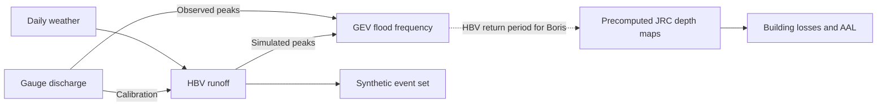
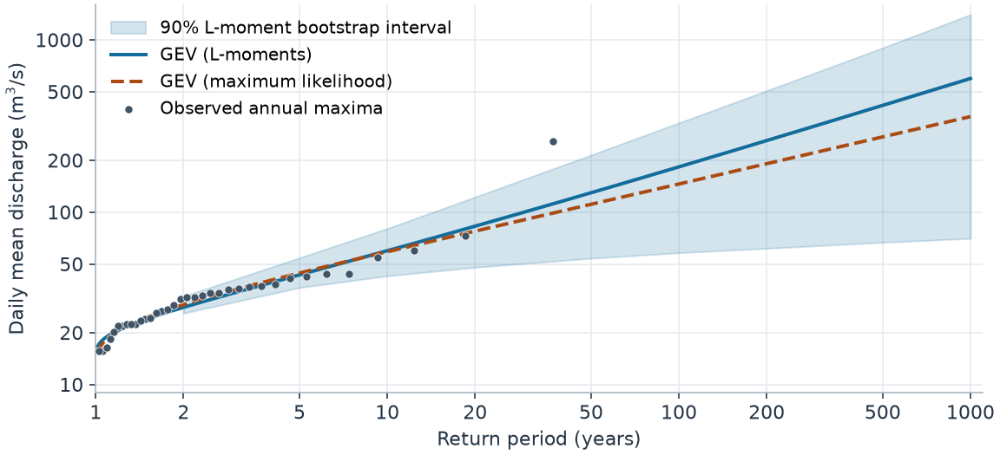

# rain2loss — from rainfall to flood loss, Morava at Raškov (Czechia)

rain2loss is a catastrophe flood modelling case study for the 350 km² catchment upstream of Raškov (LamaH-CE gauge 824). It uses a daily HBV rainfall–runoff model, flood-frequency analysis and synthetic events to characterise river flooding, then combines inundation depths, building footprints and depth–damage curves to estimate direct building losses and average annual loss.

## Pipeline



The event set ranks annual HBV peaks by empirical return period. The portfolio loss curve uses the return periods assigned to the JRC maps.

## Data

| Source | Use | Licence and citation |
| --- | --- | --- |
| LamaH-CE v1.0 | ERA5-Land forcing, gauge discharge, basin geometry and COSERO benchmark | Zenodo lists CC BY-SA 4.0 and the archive includes CC BY 4.0. Discharge from ČHMÚ (2020). [Klingler et al. (2021)](https://doi.org/10.5194/essd-13-4529-2021) · [Data and source credits](https://zenodo.org/records/5153305) |
| E-OBS v33.0e | Daily 0.1° rainfall and temperature for Boris | Non-commercial research and education. Credit UERRA, the Copernicus Climate Change Service and ECA&D data providers. [Cornes et al. (2018)](https://doi.org/10.1029/2017JD028200) · [Data and terms](https://surfobs.climate.copernicus.eu/dataaccess/access_eobs.php) |
| Copernicus DEM GLO-30 | 30 m surface model for terrain and drainage analysis | Free Copernicus DEM licence with attribution. [Dataset DOI](https://doi.org/10.5270/ESA-c5d3d65) · [Licence and attribution](https://dataspace.copernicus.eu/explore-data/data-collections/copernicus-contributing-missions/collections-description/COP-DEM) |
| JRC flood hazard maps v3.1.1 | Flood depths for nine return periods | The catalogue lists ODbL 1.0. The download notice states CC BY 4.0. [Baugh et al. (2024)](https://doi.org/10.2905/JRC.WPE5YRR) · [Download notice](https://jeodpp.jrc.ec.europa.eu/ftp/jrc-opendata/CEMS-EFAS/flood_hazard/copyright.txt) |
| OpenStreetMap | Building footprints | ODbL 1.0. [© OpenStreetMap contributors](https://www.openstreetmap.org/copyright) |
| JRC depth–damage functions | European residential curve and Czech maximum damage of €587.20/m² in 2010 prices | EU report reuse with source acknowledgement and preservation of meaning. [Huizinga et al. (2017)](https://doi.org/10.2760/16510) |

## Results

### HBV vs COSERO

Daily discharge scores for calibration (Jan 1982–Sep 2000) and validation (Oct 2000–Sep 2017). [Full scores](results/hbv_scores_824.csv)

| Model | Cal. NSE | Cal. KGE | Val. NSE | Val. KGE |
| --- | ---: | ---: | ---: | ---: |
| HBV (DDS) | 0.685 | 0.839 | 0.535 | 0.707 |
| HBV (SCE-UA) | 0.674 | 0.821 | 0.545 | 0.737 |
| COSERO | 0.740 | 0.770 | 0.584 | 0.735 |

### Flood frequency

Generalised extreme value (GEV) fits to 36 observed annual maxima of daily mean discharge (Nov–Oct water years, 1982–2017). The L-moment intervals are the 5th–95th percentiles of 1,000 bootstrap refits. [Full estimates](results/flood_frequency_824.csv)

| Return period (years) | L-moments (m³/s) | 90% interval (m³/s) | Maximum likelihood (m³/s) |
| ---: | ---: | ---: | ---: |
| 2 | 28.0 | 25.9–32.5 | 29.1 |
| 5 | 43.3 | 36.5–54.4 | 44.3 |
| 10 | 59.7 | 42.6–80.4 | 58.9 |
| 20 | 82.9 | 47.8–122.4 | 77.6 |
| 50 | 129.6 | 54.0–214.6 | 111.1 |
| 100 | 183.1 | 58.1–329.8 | 145.7 |
| 200 | 260.2 | 61.6–506.6 | 191.0 |
| 500 | 416.5 | 66.8–899.3 | 273.3 |
| 1,000 | 596.5 | 70.4–1,400.4 | 358.6 |



### Event set

Both variants use the same 1,000 resampled water years and retain 999 annual peaks after warm-up. The largest peak is 170.3 m³/s with whole-year resampling and 369.9 m³/s with lognormal scaling of each year's wettest five-day spell (σ = 0.2). [Event-set notebook](notebooks/06_extremes_event_set.ipynb)


### Loss by return period

The undefended average annual loss (AAL) is **€599,594/year**, or **0.75%** of the €80.3m portfolio across 768 buildings. [Full loss table](results/loss_by_return_period_824.csv)

| Return period (years) | 10 | 20 | 30 | 40 | 50 | 75 | 100 | 200 | 500 |
| --- | ---: | ---: | ---: | ---: | ---: | ---: | ---: | ---: | ---: |
| Loss (€m, 2010 prices) | 5.49 | 5.87 | 6.07 | 6.19 | 6.29 | 6.49 | 6.60 | 6.90 | 7.23 |


### Storm Boris, September 2024

HBV driven by bias-corrected E-OBS peaks at **325 m³/s** (daily mean, 14 Sep). The ČHMÚ instantaneous peak estimate is **340 m³/s** (15 Sep). The simulated peak has a **415-year** return period in the historical HBV climate. The nearest JRC scenario (500 years) gives **€7.23m** in loss across 193 buildings. The critical success index (CSI) is unavailable because the catchment lacks an observed flood footprint for validation. [Boris notebook](notebooks/08_boris_2024.ipynb) · [Šercl et al. (2025), Table 1](https://www.chmi.cz/documents/d/chmi.cz/10-59984-mz-2025-06-02#page=3)

## Assumptions and limitations

- **Hazard.** Undefended JRC depths at ~90 m are sampled at one point per building. Areas flagged for spurious depths account for 24% of estimated 100-year loss. AAL assumes zero loss for events more frequent than the 10-year flood and holds loss flat beyond the 500-year flood.
- **Hydrology.** Daily mean and instantaneous peaks have different time scales. Gridded weather, HBV parameters and the short gauge record all affect tail estimates. Plain year-block resampling cannot generate more extreme weather than the historical inputs. Storm scaling extends the tail according to the chosen σ.
- **Exposure.** The hypothetical portfolio uses OSM footprint area and generic residential depth–damage ratios at 2010 prices.

## How to run

From the repository root, create and activate the environment, then install the package.

```sh
conda env create -f environment.yml
conda activate rain2loss
pip install -e .
```

Extract `2_LamaH-CE_daily.tar.gz` into `data/raw/LamaH-CE/` so the `A_basins_total_upstrm/` and `D_gauges/` folders sit directly inside it. Run the first four cells of the loss notebook to make `data/processed/buildings_824.gpkg` and the nine `data/processed/jrc/jrc_rp*_824.tif` files. [LamaH download](https://zenodo.org/records/5153305) · [Loss notebook](notebooks/07_loss.ipynb)

```sh
python -m rain2loss.run --config config.yaml
pytest -q
```

The CLI writes to `results/run_824/`. The figures and tables above use the saved notebook results. For the Boris analysis, prepare the E-OBS rainfall subset in the raster GIS notebook and then run the Boris notebook. [Raster GIS notebook](notebooks/04_raster_gis.ipynb) · [Boris notebook](notebooks/08_boris_2024.ipynb)

## Using another catchment

1. **Select a LamaH-CE gauge.** Copy `config.yaml` to `config.local.yaml`. Set `gauge_id` and `periods` for its record, and use a fresh `output_dir` so HBV calibrates for the new gauge.
2. **Prepare local hazard and exposure.** Set `loss.buildings` to the building footprints and `loss.hazard_pattern` to depth rasters in metres, with `{rp}` as the return-period placeholder. Set `loss.return_periods` to match the rasters. Where JRC maps cover the catchment, change `GAUGE_ID` in the loss notebook to prepare both inputs. [Loss notebook](notebooks/07_loss.ipynb)
3. **Run** `python -m rain2loss.run --config config.local.yaml`.

Outside LamaH-CE, adapt the runner's data reader to supply daily rainfall, temperature, potential evapotranspiration and observed discharge, plus catchment area and elevation. For a new region, check whether the Czech building values, European residential damage curve, EPSG:3035 area projection and November–October water year fit the local setting.
